# Git Deploy

A lightweight, self-hosted Git watcher and Docker Compose deployment dashboard. Add a repository, clone a branch, and deploy it manually once; Git Deploy then polls that branch and redeploys when it advances.

> **Administrator access only.** An authenticated administrator can run arbitrary shell commands and control Docker on the host. Docker socket access is effectively host-root access. Do not expose this service directly to the internet or use it for untrusted users, repositories, or scripts. See [deployment and security](DEPLOYMENT.md) before installing.

## What it does

- Light and dark themes with selectable accent colors, repository filters and status colors, collapsible repository cards, a developer guide, and a centralized activity feed. Cards start collapsed; display preferences are saved in the browser's local storage across reloads and logouts.
- Expand a repository card for Deploy or Redeploy; other operations, including activity, settings, environment editing, and removal, are under **More actions**.
- Clone HTTPS or `ssh://` repositories, select a branch (default `main`), and manually deploy.
- For a deployment, run `git pull --ff-only origin <branch>`, `docker compose up -d --build`, an optional custom shell script, `docker compose ps`, and `docker compose logs --tail=100` (all services).
- After the first successful deployment, **Redeploy** additionally passes `--force-recreate`; automatic updates retain the normal Compose behavior.
- **View page** opens a chooser using the repository `.env` `DOMAIN`, or its published TCP ports if no domain is set.
- Poll deployed repositories for changes, deploy fast-forward updates, and pause or resume watching. A repository is not automatically deployed until its first manual deployment succeeds.
- Show Git Deploy process and configured Docker host summaries on the dashboard, per-container summaries on repository cards (including when collapsed), and detailed bars for all three on the metrics page; persist deployment state and recent activity across restarts.
- Graph recent CPU, memory, container network and block I/O rates in the current browser session. Manage containers belonging to deployed repositories, including lifecycle actions, logs, inspect and process lists.
- Choose one, two, or three repository, container-card, and graph columns. Container metrics cards start collapsed; expand them for details and use the graph buttons to show or hide CPU, memory, network, or disk I/O graphs. Layout, visibility and expansion choices are saved in local storage on this browser.
- Repository cards use an icon found in the clone, or a default icon. Discovery checks `favicon.ico`, `favicon.png`, `icon.png`, `logo.png`, `favicon.svg`, `icon.svg`, and `logo.svg` in the repository root, `public`, `static`, `assets`, `public/assets`, `src/assets`, and `app`. Only regular files up to 128 KiB are used; symlinks are ignored.
- Require a fresh authenticator code for manual deployments, repository deletion, and container stop, kill, restart and pause. Codes cannot be reused, including immediately after login.
- Use a managed HTTPS token or generate an SSH deploy key for a private repository.
- Edit a repository's root `.env` after cloning, before or between deployments.
- Remove a repository and its clone, with optional Compose service and locally built image cleanup.

## Screenshots

These screenshots use example repositories and simulated container data; they do not represent real deployments.

| Workspace | Operations |
| --- | --- |
| 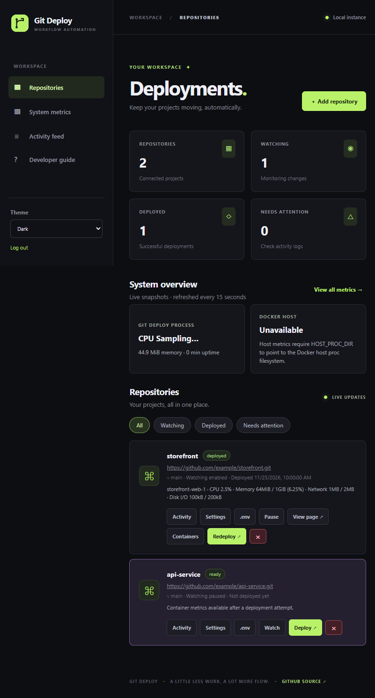 | 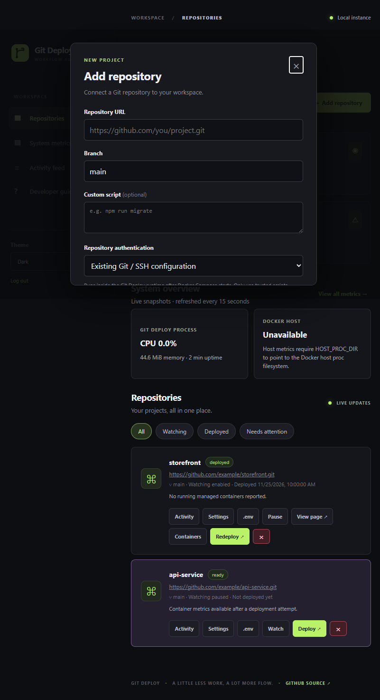 |
| Repository dashboard, status filters and actions | Connect a repository and configure Git authentication |
| 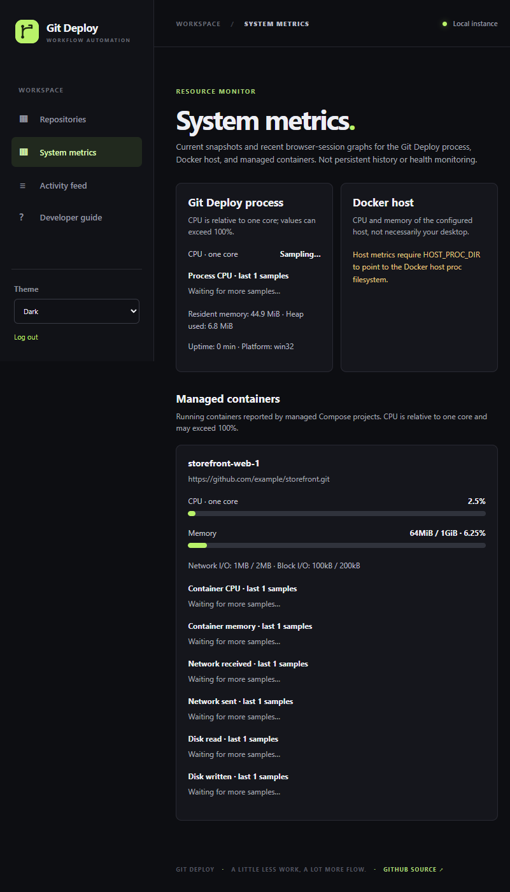 | 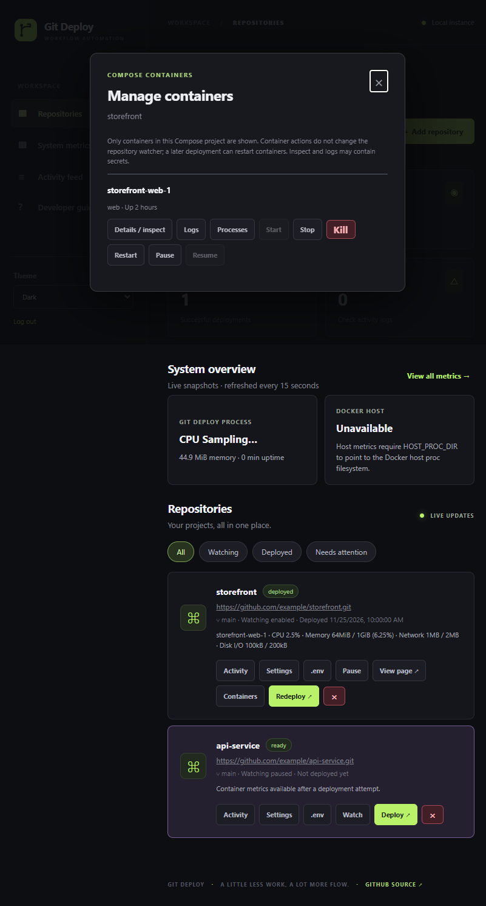 |
| System and container metrics | Container inspection, logs and lifecycle controls |
| 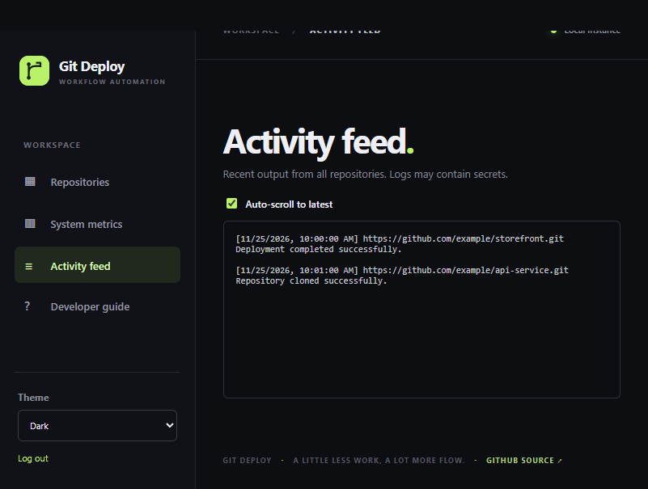 | 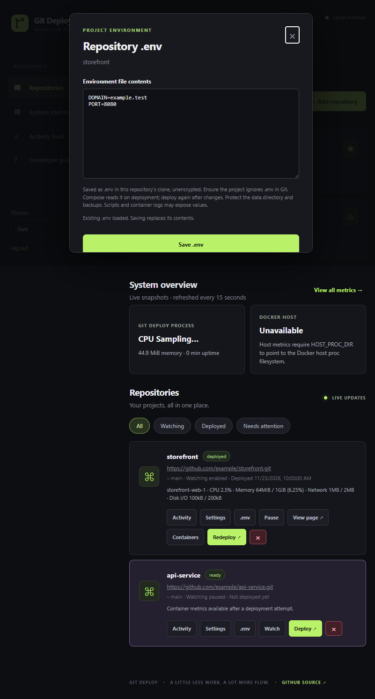 |
| Deployment activity | Repository environment editor |
| 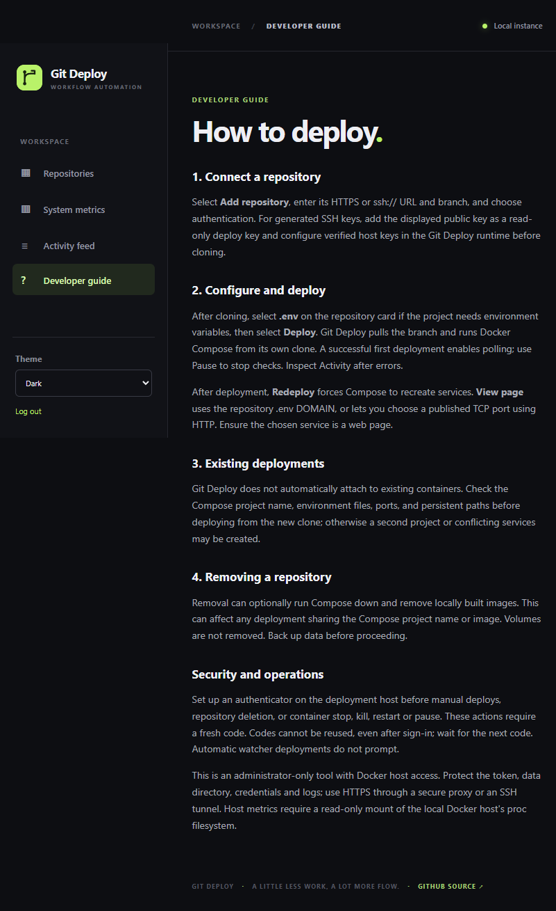 | 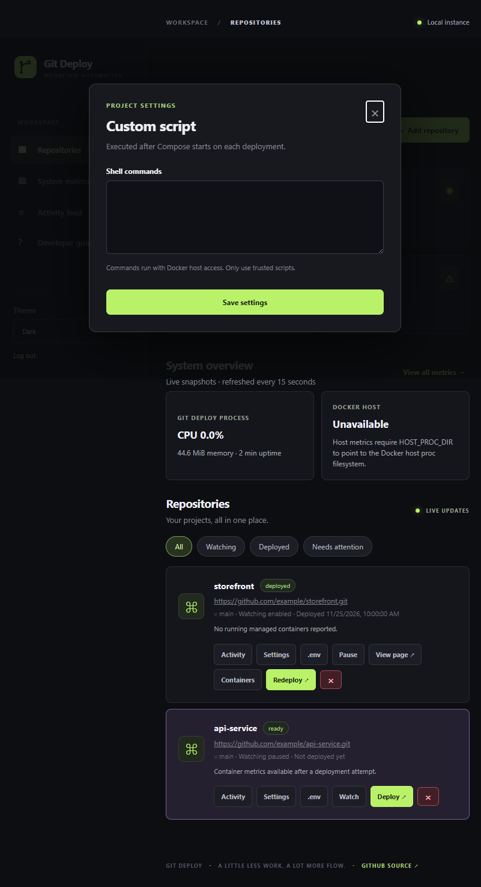 |
| Built-in deployment guide | Repository script and credential settings |
| 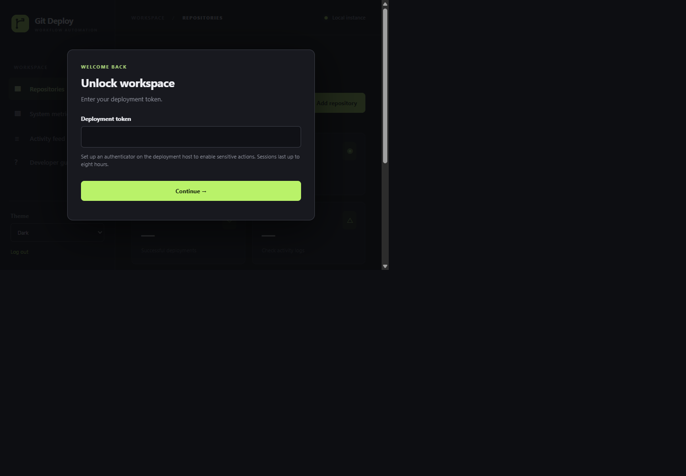 | 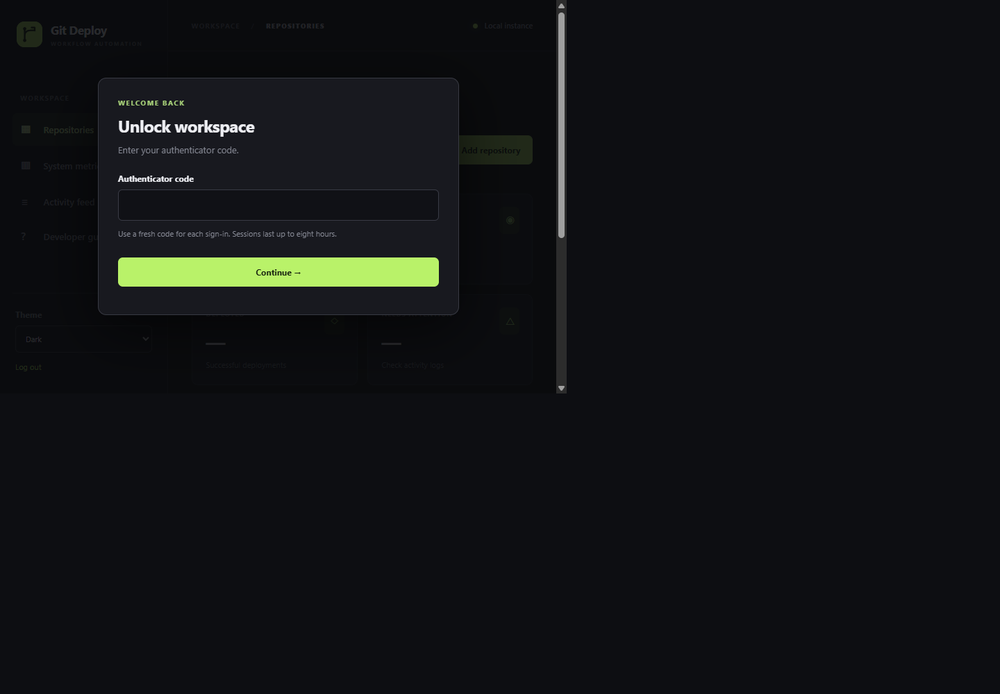 |
| Workspace unlock before enrollment | Workspace unlock after enrollment |
| 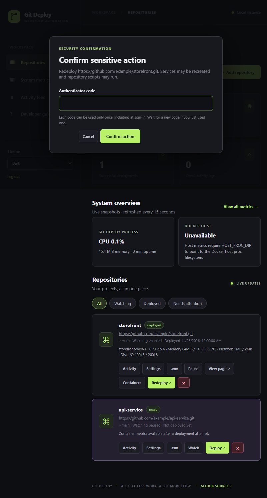 | |
| Fresh-code confirmation for protected actions | |

## Quick start

Requirements: Node.js 20.6+, Git, Docker with the Compose plugin, and permissions to use the Docker daemon. Set `DEPLOY_TOKEN` in `.env` (or in the shell environment) on the machine where the containers should run, then start the app:

```sh
npm start
```

Open <http://127.0.0.1:3000> and unlock the workspace with the deployment token. On the deployment host, run `node --env-file=.env auth-admin.js setup` in an interactive terminal and scan the QR code with an authenticator app (or enter the displayed key manually). Enrollment invalidates token-only sessions; after confirming the code, wait for the next code and sign in using the authenticator code alone. Select **Add repository**, supply the clone URL and branch, optionally add a shell script, and wait for cloning to finish. Expand the repository card and, if needed, select **More actions → .env** to save the project's environment file. Select **Deploy** and enter a fresh authenticator code to perform the first deployment; use **More actions → Activity** to inspect output. Thereafter the watcher checks for changes every 60 seconds by default.

Before enrollment, token-only login grants administrative access, but manual deployment, repository deletion, and protected container actions are blocked. After enrollment, authenticator-only login is **single-factor authentication**, not two-factor authentication; protect the authenticator and use additional access controls such as a VPN or HTTPS proxy. See [deployment and security](DEPLOYMENT.md).

For running the application itself in Docker, private repositories, configuration, troubleshooting, and security details, see [DEPLOYMENT.md](DEPLOYMENT.md).

## Configuration

| Environment variable | Default | Description |
| --- | --- | --- |
| `DEPLOY_TOKEN` | required | Shared administrator token, at least 16 characters; use a long random value. |
| `HOST` | `127.0.0.1` | HTTP listen address. The supplied container sets this to `0.0.0.0`. |
| `PORT` | `3000` | HTTP listen port. |
| `DATA_DIR` | `./data` | Persistent state and repository clones. |
| `POLL_INTERVAL_SECONDS` | `60` | Poll interval, integer of at least 10 seconds. |
| `HOST_PROC_DIR` | unset | Path to the local Docker host's proc filesystem for host CPU and memory metrics; see deployment instructions. |

Run the focused tests with `npm test`. They use temporary Git and Docker stand-ins and do not deploy containers.

## Code organization

The server entry point initializes state and wires the HTTP server, API router, endpoint handlers, session service, repository operations, command runner, validation, and metrics services in `lib/`. The browser interface lives in `public/`, with metrics and container management in separate modules; authenticator provisioning and TOTP helpers remain separate from the server.

## Behavior and limitations

- One operation per repository runs at a time; different repositories can deploy concurrently. Run only one Git Deploy instance against a data directory.
- Failed clones can be removed and re-added. A failed check or deployment stops automatic checks for that repository; inspect **Activity**, fix the cause, and deploy manually to resume. Interrupted operations are marked as errors on restart. A non-fast-forward remote change requires manual resolution.
- The custom script runs via `sh -c` in the clone directory, **after** Compose starts. It runs in the Git Deploy container when installed with Docker, not directly on the host, so only tools installed in that runtime are available. A failure marks the deployment as failed, but does not roll back containers. Commands have a 15-minute timeout; scripts must not detach or background long-running processes. Project Compose files must be in the repository root.
- The deployed count means a deployment previously succeeded, not that containers are currently healthy. This is not a full container management system or a substitute for backups and monitoring.
- Cards highlight rebuilding, paused, and recently pulled (60 seconds) states. The latest 200 activity chunks and the most recent 40,000 characters per repository are persisted; this feed is not a tamper-proof audit log.
- Removal only runs Compose cleanup when explicitly selected; `docker compose down --rmi local` can affect other deployments sharing a project name or built image. Volumes are not deleted.
- Managed tokens and unencrypted SSH private keys are stored in the protected data directory, not in a dedicated secret manager. Logs and scripts may contain sensitive information; do not print secrets. There is no multi-user access control, audit log, deployment queue, rollback, webhook, or container health monitoring yet.
- Repository `.env` files are stored unencrypted in the managed clone. The editor will not overwrite a Git-tracked `.env`; keep it ignored by Git. Changes take effect on the next deployment. See [deployment and security](DEPLOYMENT.md#repository-environment-files).

## Suggested next steps

Consider backups and a recovery plan, off-host health monitoring and notifications, deployment approvals, per-user permissions and an audit log, secret management, and rollback/version selection before relying on this for critical workloads. Webhooks could replace polling where network and authentication requirements permit.
